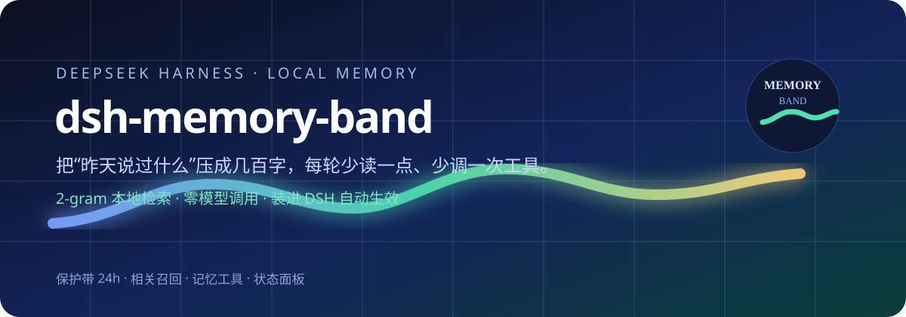
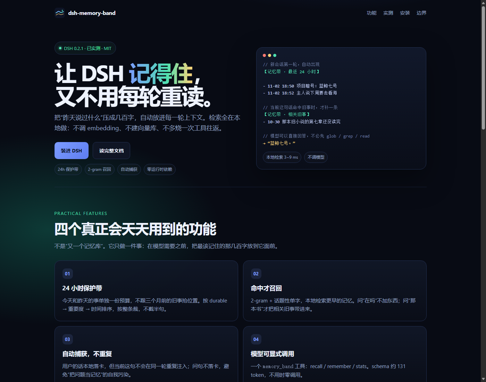

# dsh-memory-band

<p align="center">
  
</p>

<p align="center">
  
</p>

<p align="center">
  <a href="https://github.com/13576751971/dsh-memory-band">GitHub</a> ·
  <a href="site/index.html">主页</a> ·
  <a href="docs/benchmark.md">实测报告</a> ·
  <a href="docs/marketplace.md">上架说明</a>
</p>

<p align="center">
  
  
  
  
</p>

> 给 DeepSeek Harness 的本地记忆带：把“昨天说过什么”压成几百字，自动放进每一轮上下文。
> 检索全在本地做，不调模型、不建向量库；装进 DSH 就生效。

---

## 它解决的不是“存不下”，是“每轮都要重新找”

长会话里，模型要回答“我们之前约的暗号是什么”，常见的两条路都很贵：

- **把历史留得很长**：每一轮都重发，token 随会话线性上涨；
- **现场去翻文件 / 搜索**：多一次工具调用，就多一次模型 step，工具结果还要回灌上下文。

`dsh-memory-band` 选了第三条：**只带几百字、和当前这句话有关的记忆**。

它把记忆分成三段：

| 段 | 什么时候出现 | 作用 |
|---|---|---|
| **保护带** | 每个新会话的稳定前缀 | 最近 24 小时值得记的事，先兜住“昨天/刚才” |
| **相关召回** | 当前这句话命中旧事时 | 2-gram 本地检索，只带更早的、真正相关的几条 |
| **场景回放** | 命中且开启时 | 把当时的上下文一起带上，避免只有摘要没有语境 |

保护带按会话缓存，不随每轮重写；相关召回只占一个很窄的位置。两段都通过 DSH 的
`ctx.systemPrompt.context()` 注入，宿主会按投影去重。

---

## 装进 DSH

### 方式一：插件市场 / 「添加插件」

本包已经是一个标准 DSH bundle：

- `package.json` 里的 `dsh.bundle.patch` 指向 `cordis.patch.yml`
- `cordis.patch.yml` 的 `id` 等于包名 `dsh-memory-band`
- `lib/index.js` 导出 Cordis 契约（`name` / `inject` / `apply`）
- 声明了 `engines.dsh >= 0.2.0`，并带 `README`、图标、上架条目

在 DSH 的 **Plugins → 添加插件** 里粘贴下面任意一种来源：

```text
# GitHub（发布后）
https://github.com/13576751971/dsh-memory-band

# npm（发布后）
dsh-memory-band

# 本机目录（开发/内测）
C:\Users\asus\Desktop\GitHub\dsh-memory-band
```

### 方式二：CLI

```sh
dsh plugin --profile desktop add dsh-memory-band
```

装完刷新页面即可；当前 DSH 的 HMR 会重新组合插件，通常不用重启。

### 方式三：本地开发

```sh
git clone https://github.com/13576751971/dsh-memory-band
cd dsh-memory-band
node --test --test-isolation=none
```

> `--test-isolation=none` 只是为了避免 Windows 沙箱里测试 runner 拉子进程被拦；
> 普通环境直接 `npm test` 即可。

---

## 装上之后，DSH 里会发生什么

### 1. 新会话自动多一段“最近 24 小时”

不需要用户开口，也不需要模型先调用工具。新会话的第一轮就会带上类似这样一段：

```text
【记忆带 · 最近 24 小时（本地记忆，自动带入）】

## 最近 24 小时（记得最清楚）
- 11-02 18:50 DSH 记忆带实测暗号：蓝鲸七号。项目目录是 ...\dsh-memory-band。

（这是本地记忆带自动带入的旧事，不是用户这轮说的话；如果这里已经能回答，
就直接回答，别再读文件或搜索；自然用，别照读，也别提“记忆带”。）
```

### 2. 当前这句话命中旧事时，才补一条“相关旧事”

问“我们之前约的暗号是什么”，会补上更早的相关记忆；问“在吗”，则什么都不加。
命中才花预算，是这个插件和“每轮塞一大段记忆”最大的区别。

### 3. 多一个 `memory_band` 工具

模型可以显式做三件事：

| action | 用途 |
|---|---|
| `recall` | 查更早的旧事（本地检索，返回摘要） |
| `remember` | 把用户明确要求记住的一句话写进卡 |
| `stats` | 看记忆条数、注入次数、估算 token |

工具 schema 只占约 131 token；不用时不会产生调用。

### 4. 自动捕获“上一轮”，不捕获这一轮

用户在会话里说的话会本地落卡，但**当前这句话不会在同一轮里重复注入**。
自动捕获只收陈述句；问句是请求，不是记忆，默认不落卡，避免“把问题当记忆、
下一轮又召回问题”的自我污染。

### 5. 一个本地面板

插件在 DSH 的 webServer 上注册一组只接受回环访问的路由：

```text
GET  /dsh-memory-band/                 # 状态面板
GET  /dsh-memory-band/health           # 健康检查
GET  /dsh-memory-band/stats            # 条数、注入量、估算 token
GET  /dsh-memory-band/block?q=...      # 取某句话对应的召回块
GET  /dsh-memory-band/recent?limit=20  # 最近记忆
POST /dsh-memory-band/add              # 手动写一条
POST /dsh-memory-band/forget           # 按 id 删除
```

数据默认落在 `~/.dsh/dsh-memory-band/`：

```text
memory-card.json   # 记忆卡（纯 JSON，可直接备份/迁移）
config.json        # 预算、开关、提示词
```

---

## 实测：到底省不省运算？

测试环境：DSH `0.2.1-rc.5`，`deepseek-flash`，`standard` preset，两个**全新会话**，
同一个测试项目，同一个问题：

> 我们之前约定过的项目暗号是什么？只回答暗号本身，不要解释。

测试项目里有一份 12 节的 `notes.md`，暗号只出现一次。对照组关闭插件；实验组开启插件。
每组各跑 2 次，取平均。

| 指标 | 关掉插件（基线） | 开启插件 | 变化 |
|---|---:|---:|---:|
| 输入 token（uncached + cacheRead） | 76,153 | 25,474 | **−66.5%** |
| 输出 token | 219.5 | 21 | **−90.4%** |
| 总 token（输入 + 输出） | 76,372.5 | 25,495 | **−66.6%** |
| LLM step | 3 | 1 | **−66.7%** |
| 工具调用 | 2.5 次（`pwsh` / `glob` / `read`） | 0 | **−100%** |
| LLM 耗时 | 4,276 ms | 997 ms | **−76.7%** |
| 工具耗时 | 677 ms | 0 | −100% |

单次会话的明细：

| 组 | 会话 | 输入 | 输出 | step | 工具 | LLM |
|---|---|---:|---:|---:|---:|---:|
| 基线 | `session-0017feef…` | 76,251 | 264 | 3 | 3 | 4,646 ms |
| 基线 | `session-6417d238…` | 76,055 | 175 | 3 | 2 | 3,905 ms |
| 插件 | `session-41408faa…` | 25,390 | 5 | 1 | 0 | 922 ms |
| 插件 | `session-b33bca05…` | 25,558 | 37 | 1 | 0 | 1,072 ms |

两次实验组都只用了 1 个 step，直接回答“蓝鲸七号”；两次基线都先列目录/搜索/读文件，
用了 3 个 step。清掉测试问句后再复验一次，保护带降到 201 字，仍是 1 step / 0 工具 /
25,363 输入 token / 6 输出 token。完整记录、会话 ID 和复现脚本见
[docs/benchmark.md](docs/benchmark.md)。

### 省下来的到底是什么

1. **少 2 个 LLM step**：每一步都要重新发一次上下文。3 步 → 1 步，是最大头。
2. **少 2~3 次工具调用**：`pwsh` 列目录、`glob`/`grep` 搜索、`read` 读文件，
   以及工具结果回灌的上下文。
3. **少输出 token**：不用再复述“我查到了……根据文件……”，直接给答案。
4. **本地检索替代向量检索**：没有 embedding API、没有向量库、没有检索侧模型调用。

### 它自己花多少

| 成本项 | 实测 |
|---|---:|
| 保护带 | 201~245 字（约 134~164 token） |
| 相关召回 | 0~145 字（命中旧事时才有） |
| `memory_band` 工具 schema | 约 131 token |
| 本地检索 | 单次 3~9 ms（1000~3000 条） |

所以它**不是“零成本”**，而是“用两三百字换掉几千字的重复上下文和工具往返”。

### 什么时候省不了

- 模型仍然坚持去读文件确认：这一次的 3 个 step 就省不掉。提示词末尾已经明确
  “这里能回答就直接回答，别再读文件或搜索”，但模型行为仍有随机性。
- 问题指向“某个文件里的某一节”，而不是“我们之前说过的事”：模型更倾向于查文件，
  这时记忆带的价值是兜底，不是替代。
- 记忆卡是空的：只有骨架，没有可注入的内容，自然不会省。

### 一个必须说清的成本口径

上表的“输入 token”把 `cacheReadTokens` 也算进去了，因为那仍然是模型要处理的上下文。
但**缓存命中价通常远低于未命中价**，所以“token 少 66%”不等于“账单少 66%”。
如果你只看钱，请用你自己 provider 的缓存计价再算一遍；如果你看的是**计算量、
延迟、工具往返**，上表的 step / 工具 / LLM 耗时是更直接的证据。

---

## 它是怎么做到的

```text
DSH session
  │
  ├─ systemPrompt.context("dsh-memory-band-boot")    稳定前缀，按会话缓存
  │     └─ 最近 24h 保护带（≤ 760 字）
  │
  ├─ systemPrompt.context("dsh-memory-band-recall")  当前这句话命中才出现
  │     └─ 2-gram 召回 + 场景（≤ 520 字）
  │
  ├─ agent/inbox/inserted  ──► 本地落卡（只收陈述句，当前轮不重复注入）
  ├─ session/event         ──► turn/end 提交、assistant/message 补 botReply
  │
  └─ tools.register("memory_band")  recall / remember / stats
```

检索器在 `src/`，是纯函数；插件壳在 `lib/`，只负责 DSH 生命周期、注入和落盘。
没有运行时 npm 依赖，只用 Node 内置模块。

### 为什么是 2-gram，不是向量

注入预算只有几百字，误召回一条就占掉一格；而人名、日期、数字、项目代号这些，
子串匹配比余弦相似度稳。2-gram 不依赖词典，中文不用分词，成本是零。
多义词仍然会误召回（念书/想念），这是已知限制，不是 bug 隐藏。

### 为什么保护带要独立预算

如果和召回共用一个池子，今天的闲聊和三个月前的旧事会互相挤占；而“昨天说了什么”
恰恰是最常被问的。保护带单独 760 字，按 `durable > 重要度 > 时间` 排序，按整条裁，
不把最后一条截成半句。

---

## 配置

配置文件：`~/.dsh/dsh-memory-band/config.json`（不存在时自动生成）。
也可以在 bundle patch 的 `config:` 里覆盖 `dataDir` / `bootChars` / `recallChars` / `autoCapture`。

| 字段 | 默认 | 说明 |
|---|---|---|
| `injectMaxChars.qq` | `520` | 召回段预算（字） |
| `protectionBand.windowHours` | `24` | 保护带时间窗 |
| `protectionBand.bandChars` | `760` | 保护带独立预算 |
| `protectionBand.bandImportanceMin` | `55` | 进带门槛；`durable` 不看这条 |
| `recallBand.impFloor` | `45` | 召回候选重要度地板 |
| `recallBand.recallTopK` | `0` | 最多召回几条；0 = 内置配额 |
| `scene.enabled` | `false` | 场景回放总闸（默认关闭，省预算） |
| `prompt.footer` | 见上 | 建议保留“能回答就直接回答”的指令 |

回滚：把 `protectionBand.enabled` 设为 `false`，再设 `recallBand.impFloor: 0`，
就退回“只按话题召回”的旧行为。

---

## 隐私与边界

- **全本地**：不联网、不调 embedding、不把记忆发给第三方；只有 DSH 自己的模型请求
  会带上注入块。
- **只读回环路由**：`/dsh-memory-band/*` 拒绝非 `127.0.0.1` / `::1` 请求。
- **不判断重要性**：自动捕获用启发式打分，用户可以用 `remember` 显式指定。
- **不删除原始会话**：插件只维护自己的 `memory-card.json`，不碰 DSH 的 session log。
- **不做敏感判断**：`sensitive` / `deprecated` 标了就永不进提示词；这由调用方/手动维护。

### 已知限制

- 纯指代问句（“那件事”“上次那个”）召回弱；话题栈模块默认关闭。
- 多义词会误召回；靠 `impFloor` 和预算兜住，不是硬隔离。
- 模型可能不信任注入的记忆，仍然去读文件；这时省不下工具往返。
- 保护带是“会话级缓存”，同一会话里新写入的记忆不会立刻改写已注入的前缀；
  下一个会话生效（这是为了稳定 KV cache 前缀的有意取舍）。

---

## 开发与测试

```sh
npm test                              # 46 个用例
node --test --test-isolation=none     # Windows 沙箱/无子进程环境
node examples/demo.mjs                # 三段式对照
npm run bench                         # 1000/3000 条检索耗时
```

目录：

```text
lib/index.js       Cordis 入口：注入、工具、事件、路由
lib/store.js       记忆卡读写、自动捕获、预算、统计
lib/dashboard.js   本地状态面板
src/               纯函数检索器（保护带 / 召回 / 场景 / 配置）
test/              单元测试与 bundle 契约测试
bench/             耗时与实测脚本、fixture
docs/benchmark.md  本次 DSH 实测的完整记录
docs/marketplace.md 上架条目与提交说明
site/index.html    插件主页
assets/            banner / icon
```

---

## 上架

本包已经带好市场需要的材料：

- `package.json`：`name`、`version`、`description`、`homepage`、`repository`、`engines.dsh`
- `dsh.bundle.patch` + `cordis.patch.yml`：一键安装的 bundle 层
- `README.md`：市场详情页正文
- `assets/icon.svg`、`assets/band.svg`：图标与横幅
- `docs/marketplace-entry.json`：可直接提交到 awesome-dsh-plugin 的条目
- `site/index.html`：独立主页

提交步骤见 [docs/marketplace.md](docs/marketplace.md)。

---

## License

MIT
